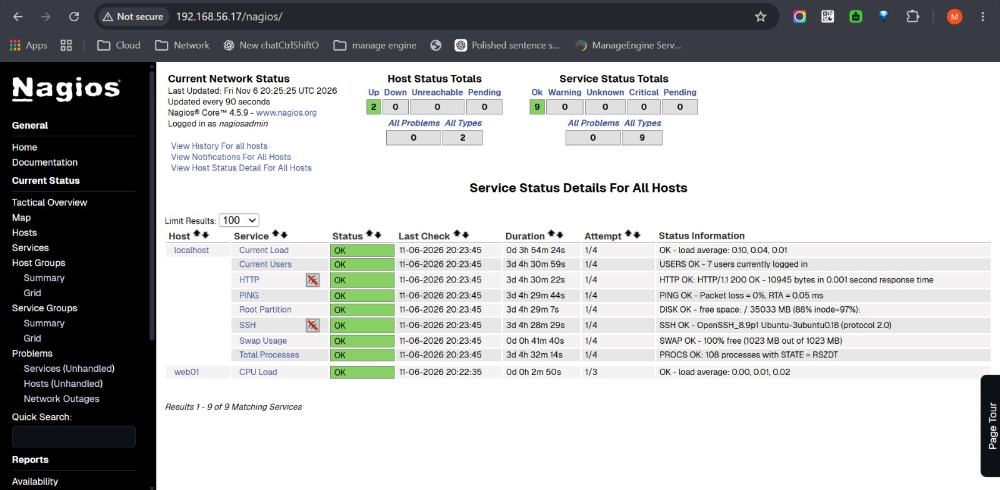
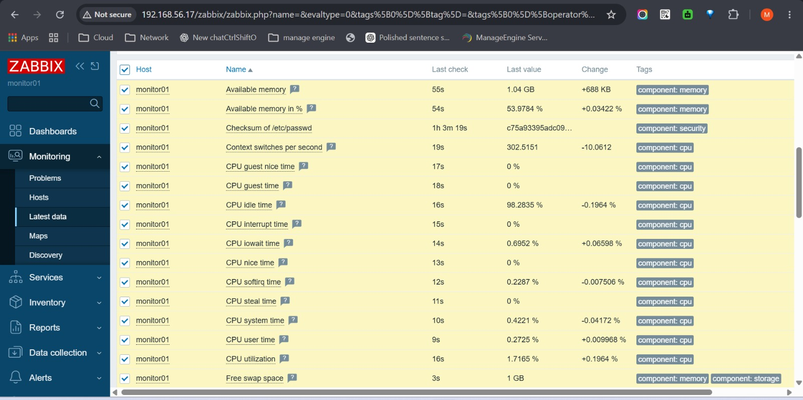

# Nagios & Zabbix Infrastructure Monitoring

A hands-on DevOps project demonstrating the deployment and configuration of two popular infrastructure monitoring solutions: **Nagios Core** and **Zabbix**.

The monitoring environment was deployed on Ubuntu 22.04 virtual machines using Vagrant and Oracle VirtualBox.

---

## Project Overview

The project focuses on monitoring Linux infrastructure, checking host availability, tracking system resources, and validating monitoring data through web-based dashboards.

### Project Objectives

- Monitor host availability and service status.
- Track Linux system resources and performance metrics.
- Configure remote monitoring between monitoring and target hosts.
- Verify monitoring functionality using Nagios and Zabbix dashboards.

---

## Technologies & Tools

| Technology | Purpose |
|---|---|
| Ubuntu 22.04 LTS | Operating System |
| Vagrant | Virtual Machine Provisioning |
| Oracle VirtualBox | Virtualization Platform |
| Nagios Core 4.5.9 | Infrastructure Monitoring |
| NRPE 4.0.3 | Remote Host Monitoring |
| Zabbix 7.0 | Infrastructure Monitoring |
| MariaDB | Zabbix Database |
| Apache | Web Server |

---

## Infrastructure Architecture

| Hostname | IP Address | Role |
|---|---|---|
| `monitor01` | `192.168.56.17` | Nagios & Zabbix Server |
| `web01` | `192.168.56.11` | Remote Linux Host |

**Monitoring Architecture:**

```text
             Monitoring Environment
                      |
               +-------------+
               |  monitor01  |
               | 192.168.56.17|
               +-------------+
                  /       \
                 /         \
          Nagios Core    Zabbix Server
              |               |
             NRPE          Zabbix Agent
              |               |
              +-------+-------+
                      |
                +-----------+
                |   web01   |
                |192.168.56.11|
                +-----------+
```

---

## Nagios Implementation

The Nagios monitoring environment includes:

- Installation and configuration of Nagios Core.
- Host and service monitoring configuration.
- Monitoring of local Linux services and system resources.
- NRPE installation and configuration on the remote host.
- Remote connectivity verification.
- Monitoring of the remote host's CPU Load.

### Nagios Validation

Remote NRPE connectivity was verified successfully:

```bash
/usr/local/nagios/libexec/check_nrpe -H 192.168.56.11
```

Expected response:

```text
NRPE v4.0.3
```

### Nagios Dashboard



---

## Zabbix Implementation

The Zabbix monitoring environment includes:

- Installation of Zabbix Server, Frontend, Agent, and MariaDB.
- Database configuration and frontend setup.
- Configuration of the Zabbix monitoring host.
- Linking the **Linux by Zabbix agent** template.
- Collection of Linux performance metrics.
- Verification of agent connectivity and monitoring data.

### Zabbix Validation

Agent connectivity was tested using:

```bash
zabbix_get -s 192.168.56.17 -p 10050 -k agent.ping
```

Expected response:

```text
1
```

### Zabbix Dashboard



---

## Testing & Validation

The monitoring environment was validated through:

| Test | Result |
|---|---|
| Nagios service checks | Successful |
| Remote host availability | Successful |
| NRPE connectivity | Successful |
| Zabbix agent connectivity | Successful |
| Zabbix Latest Data collection | Successful |

---

## Repository Structure

```text
Nagios-Zabbix-Monitoring/
│
├── README.md
├── Vagrantfile
├── .gitignore
│
├── Screenshots/
│   ├── Nagios-Services.jpeg
│   └── Zabbix-Latest-Data.jpeg
│
├── nagios/
└── zabbix/
```

---

## Conclusion

This project demonstrates the practical implementation of Nagios and Zabbix for Linux infrastructure monitoring.

It covers virtual machine provisioning, monitoring server configuration, remote host monitoring, agent connectivity, and validation of collected monitoring data.

**Both monitoring solutions were successfully deployed and tested.**